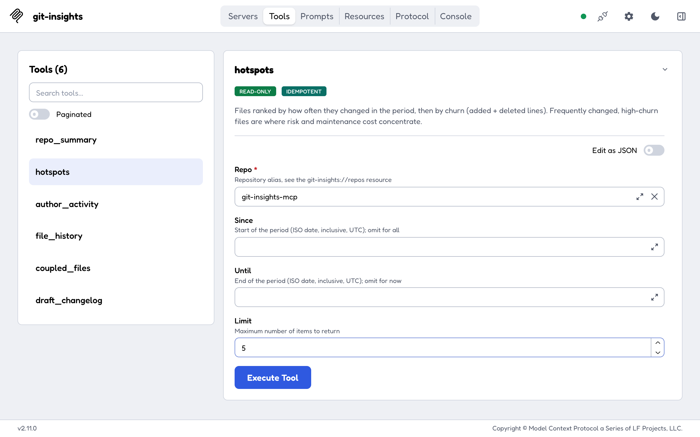
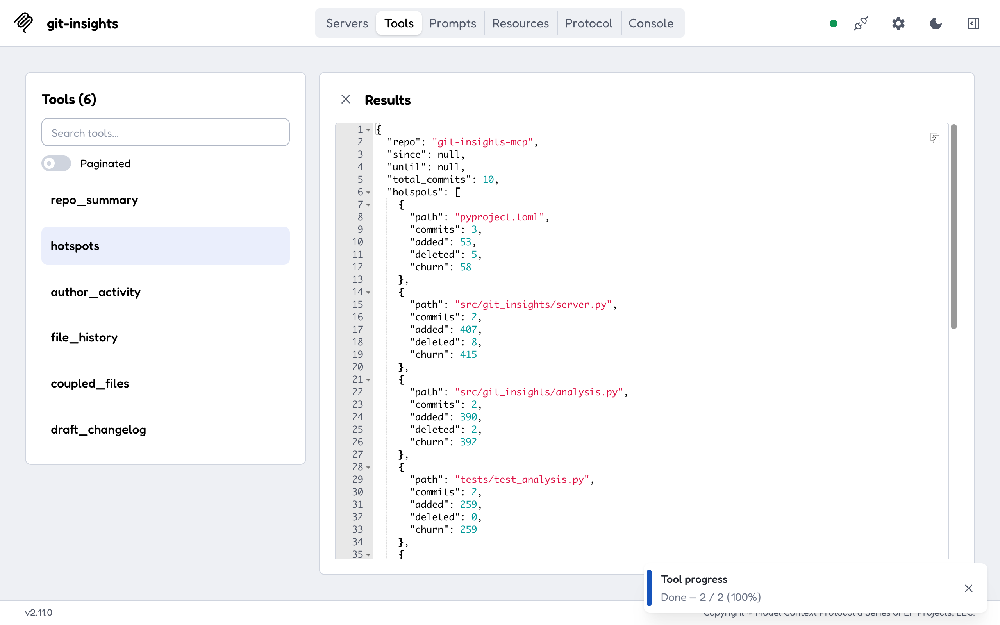
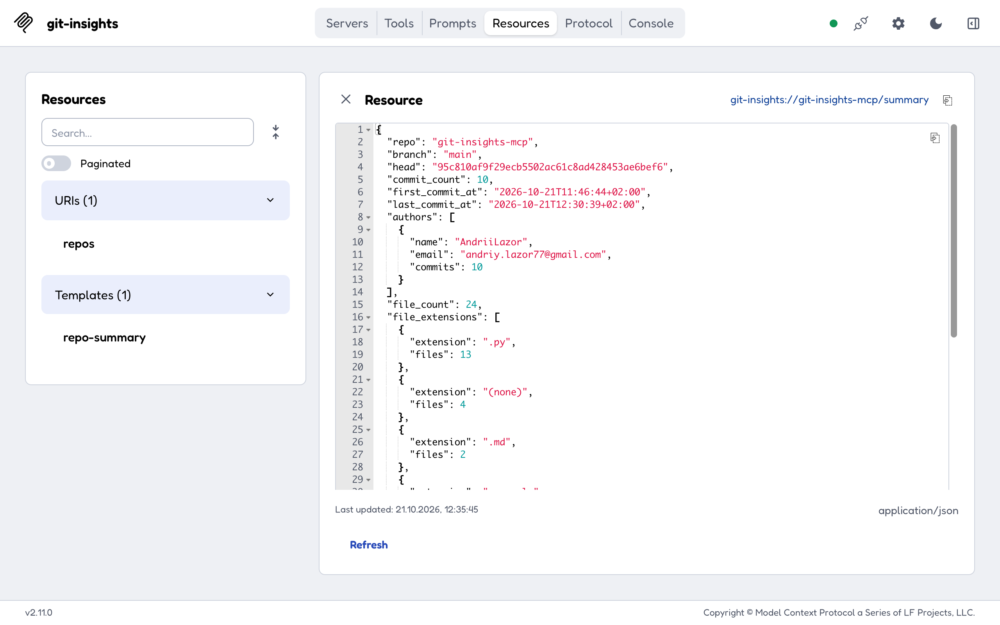
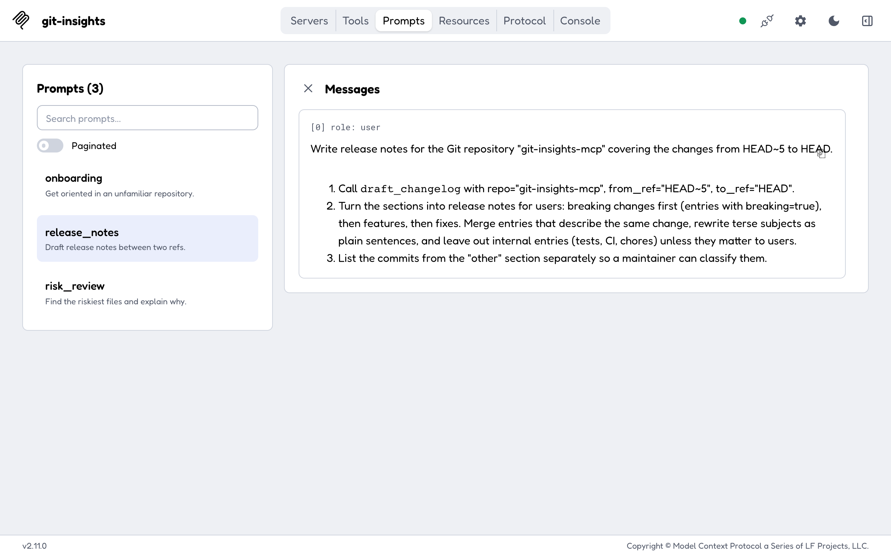

# git-insights-mcp

[](https://github.com/andriilazor/git-insights-mcp/actions/workflows/ci.yml)

A read-only [Model Context Protocol](https://modelcontextprotocol.io) server that lets an AI
client (Claude Code, Claude Desktop, MCP Inspector) ask questions about a local Git
repository's history:

- "Which files change most often, and where is the risk?"
- "Who worked on what in the last three months?"
- "Which files usually change together with `auth.py`?"
- "Draft a changelog between v1.2 and v1.3."

The server returns structured data and leaves interpretation to the client. It works on any
repository, needs no API keys, and never writes to the repository.

Built with the [MCP Python SDK v2](https://py.sdk.modelcontextprotocol.io) (`MCPServer`) and
managed with [uv](https://docs.astral.sh/uv/).

## What it exposes

**Tools.** All six are read-only, return Pydantic models with an output schema, and report
expected failures as tool errors the model can act on:

| Tool              | Returns                                                                       |
|-------------------|-------------------------------------------------------------------------------|
| `repo_summary`    | Branch, HEAD, commit count, first/last commit date, authors, file extensions  |
| `hotspots`        | Files ranked by change frequency, then churn, in a period (reports progress)  |
| `author_activity` | Commits and added/deleted lines per author in a period                        |
| `file_history`    | Recent commits that touched a file, with per-commit line counts               |
| `coupled_files`   | Files that change in the same commits as a given file, with ratios            |
| `draft_changelog` | Commits between two refs grouped by conventional-commit type, plus "other"    |

Periods are `since` / `until` ISO dates (`YYYY-MM-DD`), inclusive whole days in UTC.

**Resources**

| URI                              | Content                                     |
|----------------------------------|---------------------------------------------|
| `git-insights://repos`           | JSON list of the configured repository aliases |
| `git-insights://{repo}/summary`  | `repo_summary` for one alias, as JSON       |

**Prompts.** `onboarding`, `release_notes` and `risk_review` each return a ready-made user
message telling the client which tools to call and what to write from the results.

## Quick start (stdio)

You need [uv](https://docs.astral.sh/uv/getting-started/installation/) and `git`. Repositories
are configured as `alias=path` pairs in `GIT_INSIGHTS_REPOS`; tools take the alias, never a path.

Try it straight from GitHub:

```bash
GIT_INSIGHTS_REPOS="myapp=$HOME/code/myapp" \
  uvx --from git+https://github.com/andriilazor/git-insights-mcp git-insights-mcp --help
```

### Claude Code

```bash
claude mcp add git-insights \
  -e GIT_INSIGHTS_REPOS="myapp=$HOME/code/myapp" \
  -- uvx --from git+https://github.com/andriilazor/git-insights-mcp git-insights-mcp
```

Then ask, for example: *"Using git-insights, which files in myapp change most often?"*

### Claude Desktop

Add to `claude_desktop_config.json` (Settings → Developer → Edit Config) and restart:

```json
{
  "mcpServers": {
    "git-insights": {
      "command": "uvx",
      "args": ["--from", "git+https://github.com/andriilazor/git-insights-mcp", "git-insights-mcp"],
      "env": {
        "GIT_INSIGHTS_REPOS": "myapp=/Users/you/code/myapp,lib=/Users/you/code/lib"
      }
    }
  }
}
```

Claude Desktop does not use your shell's `PATH`. If it cannot find `uvx`, use the full path
from `which uvx`.

### MCP Inspector

From a clone of this repository (Node.js required):

```bash
npx @modelcontextprotocol/inspector -e GIT_INSIGHTS_REPOS="self=$PWD" \
  uv --directory "$PWD" run git-insights-mcp
```

The Inspector does not pass your shell environment to the server, so set variables with `-e`.
`uv run mcp dev src/git_insights/server.py` also opens the Inspector, but because the
environment is not passed through, every call then answers
`Server is not configured: GIT_INSIGHTS_REPOS is required`.

## Streamable HTTP with bearer authentication

Over HTTP the server requires a token:

```bash
export GIT_INSIGHTS_REPOS="myapp=$HOME/code/myapp"
export GIT_INSIGHTS_TOKEN="$(python3 -c 'import secrets; print(secrets.token_urlsafe(32))')"
uvx --from git+https://github.com/andriilazor/git-insights-mcp \
  git-insights-mcp --transport streamable-http --host 127.0.0.1 --port 8000
```

The endpoint is `http://127.0.0.1:8000/mcp`. Requests without `Authorization: Bearer <token>`
get `401`. Connect Claude Code with:

```bash
claude mcp add --transport http git-insights http://127.0.0.1:8000/mcp \
  -H "Authorization: Bearer $GIT_INSIGHTS_TOKEN"
```

### Docker

The image is built with uv, runs as a non-root user, and expects repositories mounted read-only:

```bash
docker build -t git-insights-mcp .
docker run --rm -p 127.0.0.1:8000:8000 \
  -v "$HOME/code/myapp:/repos/myapp:ro" \
  -e GIT_INSIGHTS_REPOS=myapp=/repos/myapp \
  -e GIT_INSIGHTS_TOKEN="$GIT_INSIGHTS_TOKEN" \
  -e GIT_INSIGHTS_ALLOWED_HOSTS=localhost:8000,127.0.0.1:8000 \
  git-insights-mcp
```

Or use the compose example: `cp .env.example .env`, set `GIT_INSIGHTS_TOKEN` and `REPO_PATH`,
then run `docker compose up --build`. CI builds the image on every push, runs it this way and
checks the `401` and an authenticated `tools/call` over HTTP.

## Configuration

| Variable                        | Default            | Purpose                                                                      |
|---------------------------------|--------------------|------------------------------------------------------------------------------|
| `GIT_INSIGHTS_REPOS`            | required           | `alias=path` pairs, comma-separated                                          |
| `GIT_INSIGHTS_TOKEN`            | (none)             | Bearer token, required for `--transport streamable-http`                     |
| `GIT_INSIGHTS_ALLOWED_HOSTS`    | (none)             | Accepted `Host` headers over HTTP, e.g. `git-insights:8000` or `myhost:*`    |
| `GIT_INSIGHTS_ISSUER_URL`       | `http://localhost` | Authorization server advertised to HTTP clients (a stand-in, see below)      |
| `GIT_INSIGHTS_GIT_TIMEOUT`      | `10`               | Seconds one git call may run before it is killed                            |
| `GIT_INSIGHTS_MAX_OUTPUT_BYTES` | `5000000`          | Largest output one git call may produce                                      |

The SDK v2 no longer reads `MCP_*` variables, so the server reads its own and passes them on.

Command line: `git-insights-mcp [--transport stdio|streamable-http] [--host HOST] [--port PORT]`.

## Demo transcript

A real Claude Code session in print mode, connected to this server over stdio, run against
this repository on 2026-10-21 when it had 10 commits.

> **Prompt:** Using the git-insights tools on the repository 'git-insights-mcp': which files
> change most often, which files usually change together with src/git_insights/server.py, and
> who has worked on the project? Keep the answer short.

Tool calls made by the client:

```text
hotspots        {"repo": "git-insights-mcp", "limit": 10}
  → total_commits 10; pyproject.toml 3 commits (churn 58), src/git_insights/server.py 2 (415),
    src/git_insights/analysis.py 2 (392), tests/test_analysis.py 2 (259), ...
coupled_files   {"repo": "git-insights-mcp", "path": "src/git_insights/server.py", "limit": 10}
  → file_commits 2; pyproject.toml, src/git_insights/__init__.py, src/git_insights/config.py,
    src/git_insights/security.py, tests/test_server.py, ... each co_changes 1, ratio 0.5
author_activity {"repo": "git-insights-mcp"}
  → AndriiLazor: 10 commits, +3910 / -25 lines
```

Answer:

> The repo only has 10 commits, so treat these numbers as early signals rather than settled
> trends.
>
> **Files that change most often**
> 1. `pyproject.toml` changed in 3 commits.
> 2. `server.py`, `analysis.py`, `models.py`, `security.py`, `config.py`, `ci.yml`,
>    `test_analysis.py` and `test_security.py` changed in 2 commits each.
> 3. `server.py` has the most churn (415 lines), followed by `analysis.py` (392).
>
> **Files that change with `src/git_insights/server.py`**
> `server.py` has only 2 commits. Each of these files changed alongside it in one of them
> (50%): `pyproject.toml`, `__init__.py`, `config.py`, `security.py`, `tests/__init__.py`,
> `test_http_auth.py`, `test_security.py` and `test_server.py`. With so little history, this
> doesn't show any real coupling yet.
>
> **Contributors**
> AndriiLazor (email omitted here) is the only author. They made all 10 commits, adding about 3,910 lines and
> deleting 25.

## Screenshots (MCP Inspector)

The `hotspots` tool. Its form comes from the input schema, and the READ-ONLY and IDEMPOTENT
badges come from the tool annotations:



Structured result, with the progress notification in the corner:



The `git-insights://{repo}/summary` resource template, read as `application/json`:



The `release_notes` prompt:



## Security

The server is read-only by design, and its defaults are restrictive:

- **Repository allowlist.** Only repositories in `GIT_INSIGHTS_REPOS` can be read. Their
  paths are resolved once at startup, and tools take the alias. Resource templates take the
  alias as well, never a path.
- **File arguments stay inside the repository.** Absolute paths, `..`, null bytes, leading
  `-` and symlinks that resolve outside the repository are rejected. Paths are always passed
  after `--`.
- **Refs cannot become options.** A ref must be a single revision (branch, tag, hash,
  `HEAD~3`). Anything starting with `-`, containing `..`, whitespace or shell
  metacharacters is rejected.
- **Restricted git.** Only `log`, `rev-list`, `show`, `shortlog` and `diff` in its
  `--stat`/`--numstat`/`--shortstat` forms are allowed. Arguments go as a list, never through
  a shell. `core.fsmonitor` is disabled, prompts are off, and optional locks are skipped.
- **Limits.** Every git call has a timeout and an output cap. When a limit is hit, the client
  gets a tool error asking it to narrow the query, not silently truncated data.
- **HTTP auth.** `--transport streamable-http` refuses to start without `GIT_INSIGHTS_TOKEN`.
  The token is checked with a constant-time comparison through the SDK's `TokenVerifier` and
  `AuthSettings`. The SDK requires an `issuer_url`, and `GIT_INSIGHTS_ISSUER_URL` is only a
  **stand-in for a real authorization server**: this server never issues tokens and does not
  implement OAuth. Put it behind a real identity provider before exposing it beyond your
  machine.
- **DNS rebinding.** Localhost binds check `Host` and `Origin` automatically. For any other
  bind (Docker, remote), set `GIT_INSIGHTS_ALLOWED_HOSTS`. Without it, the server logs a
  warning that Host headers are not checked.
- **Container.** The image runs as uid 10001. Repositories should be mounted `:ro`, and the
  compose example also makes the root filesystem read-only. The image trusts every mounted
  directory for git (`safe.directory '*'`), because mounts belong to another uid.
- **Logging** goes to stderr; stdout is reserved for the stdio protocol.

Configured repositories are trusted: git still honours a repository's own config for read
operations, so only configure repositories you would run `git log` in yourself.

## Development

```bash
uv sync                # create .venv with runtime and dev dependencies
uv run pytest          # unit + end-to-end tests (in-memory client, stdio, HTTP)
uv run ruff check      # lint
uv run ruff format     # format
uv run mypy            # strict type checking
```

Tests build a temporary repository with a hand-checked history (`tests/conftest.py`), so every
expected number in `tests/test_analysis.py` can be verified by reading the table there. CI runs
the same commands on Python 3.11, 3.12 and 3.13, plus the Docker smoke test.

```text
src/git_insights/
├── server.py     # MCPServer: tools, resources, prompts, result cache, CLI (--transport)
├── git.py        # async git runner: subcommand allowlist, timeout, output cap
├── analysis.py   # hotspots, coupling, changelog grouping and the other analyses
├── models.py     # Pydantic result models
├── security.py   # alias resolution, path/ref validation, bearer token verifier
└── config.py     # GIT_INSIGHTS_* environment variables
```

Results are cached in memory, keyed by the commit hashes they depend on, so a new commit
never serves stale data. The product requirements and implementation plan are in
[docs/PRD.md](docs/PRD.md).

## License

[MIT](LICENSE)
